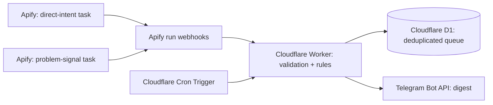

# Threads Lead Automation

**Automated Threads lead discovery and rule-based qualification with Apify, Cloudflare Workers, D1, and Telegram.**

A lightweight, event-driven workflow that monitors public Threads posts for direct requests for a mental-health professional and for expressions of related problems. It filters out obvious promotions and replies, deduplicates accepted posts, and delivers a compact Telegram digest. The original use case is Russian-language psychologist discovery, but the pipeline pattern is reusable.

> **Implementation:** Rule-based filtering, **not LLM-based AI classification**. No claim is made about perfect lead accuracy or complete coverage of Threads search.

## Architecture



## What the workflow does

- Runs **two Apify keyword-monitoring tasks** on separate schedules: direct-intent search every 15 minutes and problem-signal search every 30 minutes.
- Uses a **60-minute rolling search window** and Apify's `onlyNew` setting to mitigate delayed indexing and repeated results.
- Applies keyword and intent filters in **Apify before per-result billing**, then more precise rules in the Worker.
- Requires `is_reply === false`, filters promotions and recruitment, and checks publication age and source URL.
- Uses **D1** to deduplicate URLs and hold pending notifications.
- Sends **up to eight** prioritized posts per digest, at most once per 30 minutes, through the Telegram Bot API.
- Handles signed webhook requests via a secret header and sends alerts only after successful Apify runs.

## Repository structure

| Path | Purpose |
|---|---|
| `src/worker.js` | Worker implementation (webhook, rule-based classifier, D1 queue, Telegram digest) |
| `config/*.example.json` | Non-secret snapshots of Apify task inputs |
| `database/schema.sql` | D1 schema, **not** production data |
| `docs/architecture.md` | Workflow details, configuration, operational notes |
| `tests/filters.test.js` | Synthetic classification and validation tests |
| `.github/workflows/ci.yml` | Dependency-free Node.js test run on push/PR |

## Configuration

1. Create a Cloudflare D1 database and execute `database/schema.sql` once.
2. Create a Worker with `src/worker.js` and bind the D1 database as `DB`.
3. Configure these secrets and variables in Cloudflare **outside this repository**:

   | Binding | Use |
   |---|---|
   | `APIFY_API_TOKEN` | Fetch datasets produced by Apify runs |
   | `WEBHOOK_SECRET` | Validate `X-Webhook-Secret` on webhook requests |
   | `TELEGRAM_BOT_TOKEN` | Send bot messages |
   | `TELEGRAM_CHAT_ID` | Destination Telegram chat/group |

4. Set the Worker Cron Trigger to `*/30 * * * *` (UTC).
5. Configure two Apify tasks based on `config/*.example.json` using the Actor `reportable_broth/threads-scraper-monitor`; schedules are **15 minutes** and **30 minutes**.
6. Configure successful-run webhooks on both tasks targeting the Worker `/apify-webhook` route, with the matching `X-Webhook-Secret` header.
7. Verify `/health`, Apify webhook responses, D1 queue updates, and Telegram delivery.

**Note:** The config examples are snapshots, not one-click deployment templates. Re-check the actor's current input schema and billing settings before use. The Worker code is versioned independently; publishing changes to GitHub does **not** update the running Worker unless deployment is configured separately.

## Local tests

No external packages are required for the rule tests; Node.js 20+ is sufficient.

```bash
npm test
```

## Operational considerations

- Apify pay-per-result pricing can charge for posts subsequently rejected by the Worker; filtering as early as possible is important.
- Keyword search may include replies. The Worker rejects replies, but this **does not** eliminate Apify's charge for returned reply records.
- Search and language detection are approximate; relevant posts can be missed, and some false positives can remain.
- D1 currently stores a short text excerpt, URL, author handle, and timestamps. Do not publish live database exports.
- Secret tokens are not committed. Rotate them if accidentally exposed.
- This project processes public social-media content; outreach should respect privacy, consent, and platform rules. Expressions of crisis should not be treated as ordinary commercial opportunities.

## Status

**Working prototype in use:** Apify schedules, webhook ingestion, D1 queue, and Telegram notifications have been exercised. Intent-filter precision and spend are being iteratively tuned. No LLM-based classification is deployed.

## Potential extension

Add LLM-assisted classification behind a low-cost, deterministic prefilter, along with measured precision/recall and a human review step.
